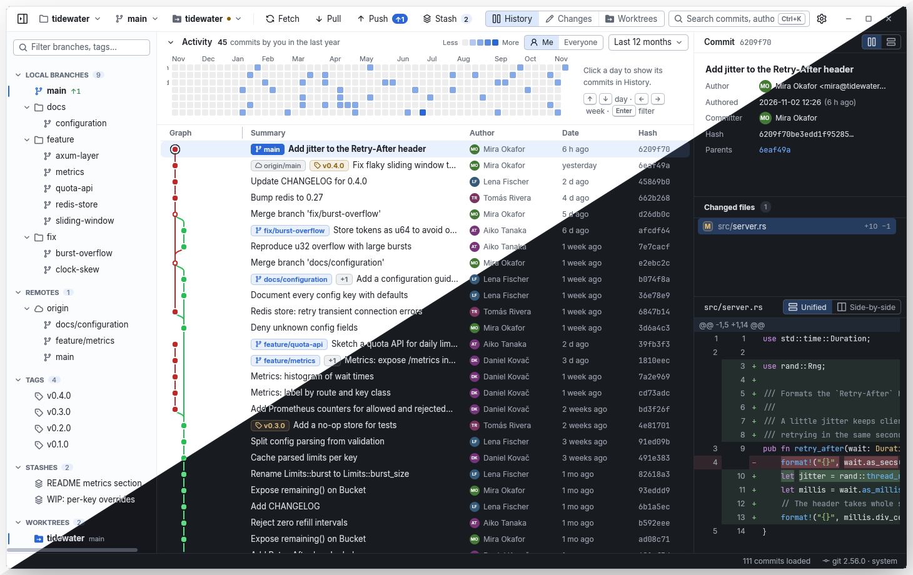

<p align="center">
  
</p>

<h1 align="center">GitWarp</h1>

<p align="center">
  A fast, native Git client for Linux, Windows and macOS.<br>
  Built with Rust and <a href="https://www.gpui.rs">GPUI</a>, the UI framework of Zed.
</p>

<p align="center">
  <a href="https://github.com/v1rus-dev/GitWarp/releases/latest"></a>
  <a href="https://github.com/v1rus-dev/GitWarp/releases"></a>
  <a href="https://github.com/v1rus-dev/GitWarp/actions/workflows/ci.yml"></a>
  <a href="#license"></a>
  
</p>

<p align="center">
  <a href="#download-and-install">Download</a> ·
  <a href="#features">Features</a> ·
  <a href="#build-from-source">Build from source</a> ·
  <a href="#privacy">Privacy</a>
</p>

<p align="center">
  
</p>

## Features

**📜 History**
- Commit graph with lane layout, streamed and virtualized so large histories open quickly
- Search through the history; collapse or expand idle lanes in the graph
- Commit details with the list of changed files and a syntax-highlighted diff
- Cherry-pick, revert and reset (soft, mixed, hard) from a commit

**✏️ Changes and commits**
- Stage and unstage whole files, single hunks or individual lines
- Discard changes, commit and amend
- Unified or split diff, whitespace options, word-level highlighting of changed characters

**🌿 Branches, tags, remotes**
- Sidebar with branches, remotes, tags, stashes and submodules
- Create, rename, delete and check out branches; create, rename and delete tags
- Stash: save, apply, pop, drop
- Fetch, pull, push (including tags), set upstream, delete remote branches
- Clone a repository, initialise a new one, add/rename/remove remotes

**🌳 Worktrees**
- Worktree switcher and a worktree manager: add, move, lock, unlock, remove and prune

**🔗 Hosting services**
- Accounts for GitHub, GitLab, Gitea/Forgejo (Codeberg), Bitbucket and Azure DevOps,
  including self-hosted instances and several accounts on the same service
- Sign in with a personal access token, or with the browser for github.com; import logins
  from the `gh` and `glab` command-line tools
- Each remote shows its service and the account in use; git over HTTPS uses that account's
  token automatically. Remotes with several push URLs push to each and report every result
- Open a commit, branch, tag, file, blame or remote on its host (no account needed)
- Clone from an account's repository list
- Pull request badges on branches, CI status on commits and checks in commit details
- Create pull requests from a branch and browse them in a sidebar panel (mine, review
  requested, all), with checkout of a pull request into a local branch

Pull requests, CI status and creating pull requests work with GitHub, GitLab and Gitea/Forgejo;
Bitbucket and Azure DevOps support accounts, git over HTTPS and opening links on the host.

**🔐 Credentials and SSH**
- Credential prompts for HTTPS remotes without an account, and a trust-on-first-use dialog for SSH host keys
- Settings page for SSH keys: list, generate and import keys, ssh-agent status, trusted hosts

**🎨 Interface**
- Light, dark or follow-the-system theme, adjustable density
- Command palette
- Customizable keybindings
- Start screen with your recent repositories and a commit activity overview
- Six interface languages (see [Languages](#languages))

## Download and install

Pick the archive for your system from the [latest release](https://github.com/v1rus-dev/GitWarp/releases/latest).
Git is bundled, so you do not need to install it separately.

| OS | Archive | Requirements |
|---|---|---|
| Linux | [`gitwarp-<version>-linux-x86_64.tar.gz`](https://github.com/v1rus-dev/GitWarp/releases/latest) | x86_64, glibc 2.35 or newer; a GPU with Vulkan support |
| Windows | [`gitwarp-<version>-windows-x86_64.zip`](https://github.com/v1rus-dev/GitWarp/releases/latest) | x86_64 |
| macOS | [`gitwarp-<version>-macos-aarch64.zip`](https://github.com/v1rus-dev/GitWarp/releases/latest) | Apple Silicon, macOS 11 or newer |

**Linux**

```sh
tar xzf gitwarp-<version>-linux-x86_64.tar.gz
cd gitwarp-<version>-linux-x86_64
./install.sh                 # installs into ~/.local, no root needed
PREFIX=/some/prefix ./install.sh
./install.sh --uninstall     # removes it again
```

**Windows**

Unzip the archive and run `gitwarp.exe`. The build is not signed, so SmartScreen
may warn about an unknown publisher: click **More info**, then **Run anyway**.

**macOS**

Unzip the archive and move `GitWarp.app` to Applications. The app is not signed with
a developer certificate or notarized, so macOS blocks the first launch. Open
**System Settings → Privacy & Security** and click **Open Anyway** next to the GitWarp message,
or remove the quarantine flag in a terminal:

```sh
xattr -dr com.apple.quarantine /Applications/GitWarp.app
```

**Checksums**

Download `SHA256SUMS.txt` next to the archive and verify it:

```sh
sha256sum -c SHA256SUMS.txt --ignore-missing
```

## Build from source

You need Rust 1.89 or newer. On Debian/Ubuntu, install the system libraries first:

```sh
sudo apt-get install -y libxkbcommon-dev libxkbcommon-x11-dev \
  libwayland-dev libvulkan-dev libfontconfig-dev libssl-dev
```

Then:

```sh
cargo run --release -p app -- /path/to/repo
```

Builds from source use the `git` on your `PATH`. See [CONTRIBUTING.md](CONTRIBUTING.md)
for the project layout, platform notes and the checks to run.

## Privacy

GitWarp can send **crash reports** (panics) to [Sentry](https://sentry.io), and nothing else.

- No breadcrumbs are recorded. The host name and user are cleared, and the home directory
  in paths and messages is replaced by `~`.
- Switch it off in **Settings → General → Privacy**. The change takes effect immediately,
  without a restart. The switch is on by default.
- Builds from source send nothing: the Sentry address is compiled in only by the release workflow.

Hosting services:

- GitWarp contacts a hosting service only for the remotes of the open repository, for
  accounts you add, and when you sign in. Nothing goes through a GitWarp server.
- Account tokens are stored in the OS keychain (macOS Keychain, Windows Credential Manager,
  Secret Service on Linux), never in `settings.json`. On Linux a Secret Service provider
  such as GNOME Keyring or KWallet must be running to add accounts.
- A token is sent only to the instance of its own account.

## Languages

English, Russian (Русский), German (Deutsch), French (Français), Spanish (Español) and
Japanese (日本語). Change it under **Settings → General → Language**.

## Contributing

See [CONTRIBUTING.md](CONTRIBUTING.md). Maintainers: the release process is in [RELEASING.md](RELEASING.md).

## License

Licensed under either of

- [Apache License, Version 2.0](LICENSE-APACHE)
- [MIT license](LICENSE-MIT)

at your option.

Unless you explicitly state otherwise, any contribution intentionally submitted for
inclusion in this project by you, as defined in the Apache-2.0 license, shall be dual
licensed as above, without any additional terms or conditions.

The bundled git is licensed under the GPLv2 and runs as a separate program; see
[packaging/git/README.md](packaging/git/README.md).
